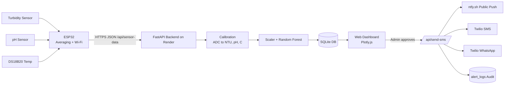
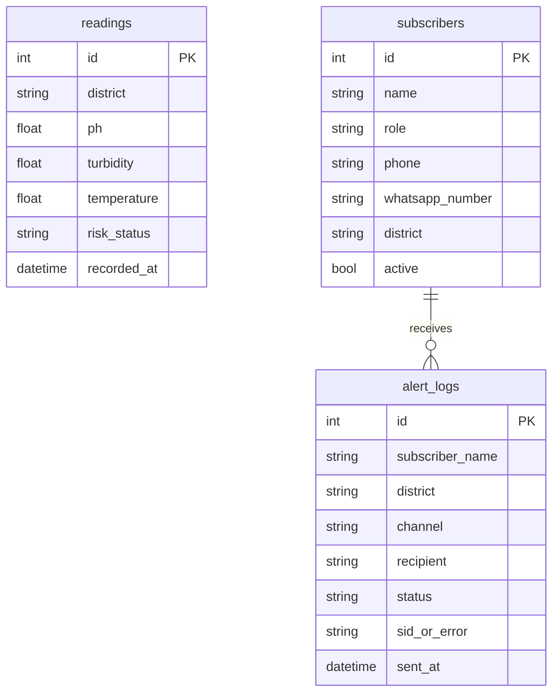

# AquaWatch – IoT-Based Waterborne Disease Early Warning System (EWS)

**Project Report & Technical Documentation**

> Items marked **[FILL]** are details I could not find in the code (names, guide, college, ML training metrics). Fill them in before submission.

---

## Table of Contents
1. Title Page Details
2. Abstract
3. Introduction
4. Problem Statement
5. Objectives
6. Scope and Limitations
7. Literature / Scientific Background
8. System Requirements
9. System Architecture
10. Hardware Design
11. Firmware Design
12. Backend Design
13. Machine Learning Module
14. Sensor Calibration
15. Disease Risk Scoring Model
16. Alerting and Notification Subsystem
17. Database Design
18. API Documentation
19. Frontend Dashboard
20. Deployment
21. Testing and Results
22. Security Considerations
23. Challenges Faced
24. Future Enhancements
25. Conclusion
26. References
27. Appendix (Viva Q&A)

---

## 1. Title Page Details
| Field | Value |
| :--- | :--- |
| Project Title | AquaWatch – IoT-Based Early Warning System for Waterborne Disease Outbreaks |
| Team / Student(s) | [FILL] |
| Guide | [FILL] |
| Institution / Department | [FILL] |
| Academic Year | [FILL] |
| Study Region | Nagaon (and Barpeta), Assam, India |
| Live Deployment | https://aquawatch-ews.onrender.com |

---

## 2. Abstract
Waterborne diseases such as cholera, typhoid, dysentery, gastroenteritis and hepatitis A repeatedly affect rural Assam, especially during floods and monsoon. Laboratory testing is slow and costly, so outbreaks are usually detected only after people fall ill. AquaWatch is a low-cost, real-time Early Warning System. An ESP32 microcontroller reads turbidity, pH and temperature sensors and sends the raw data over HTTPS to a cloud FastAPI backend. The backend calibrates the signals, then a Random Forest classifier predicts whether the water is `Low Risk - Safe` or `High Risk - Outbreak Warning`. Results are stored in a database and shown on a live web dashboard. A rule-based, pathogen-specific vulnerability index estimates the relative risk of five diseases. When risk is high, an administrator triggers a multi-channel alert: a public push notification, and SMS/WhatsApp messages to ASHA workers, medical officers and village heads. Every dispatch is recorded in an audit log.

**Keywords:** IoT, ESP32, water quality, turbidity, early warning system, Random Forest, FastAPI, waterborne disease, Twilio, public health.

---

## 3. Introduction
Access to safe drinking water is a basic public-health need. In rural Northeast India, floods carry sewage and surface runoff into ponds, tube wells and rivers. This raises turbidity and microbial load. Conventional monitoring relies on manual sampling and lab culture, which takes 24–72 hours. AquaWatch uses inexpensive physical sensors that give continuous data, and machine learning to turn that data into an actionable risk level. It also builds the communication chain from "sensor reading" to "health worker's phone".

## 4. Problem Statement
There is no low-cost, continuous, automated system that:
1. Monitors village-level water quality in real time.
2. Converts sensor data into an outbreak-risk indication.
3. Alerts the right health personnel and the public quickly, with a traceable record.

## 5. Objectives
1. Design an IoT node that measures turbidity, pH and temperature.
2. Transmit data securely to a cloud backend over Wi-Fi/HTTPS.
3. Calibrate raw sensor signals into physical units (NTU, °C, pH).
4. Classify water as safe or high risk with an ML model.
5. Estimate pathogen-specific risk for common waterborne diseases.
6. Provide a live, responsive web dashboard.
7. Automate multi-tier alerting (public push + SMS + WhatsApp) with audit logging.
8. Allow citizens to self-subscribe to alerts after phone verification.

## 6. Scope and Limitations
**In scope:** Surface/drinking water monitoring in the Nagaon district, with the architecture extendable to other districts (the data model already supports a `district` field).

**Limitations (be honest in the viva):**
- Physical sensors cannot detect pathogens directly. The system infers risk from indicators (turbidity, temperature, pH).
- The pH probe responded unreliably, so the ML model is currently given a nominal pH of 7.0 (`USE_MEASURED_PH_IN_MODEL = False`). Measured pH is still stored and displayed.
- The fourth ML feature (dissolved oxygen) is a fixed constant (15.0), because no DO sensor is installed.
- Turbidity calibration uses a 4-point empirical table from home-made samples, not certified NTU standards (e.g. formazin).
- The free cloud tier sleeps when idle, so the first request can take about 50 s.
- Twilio runs in trial/sandbox mode, so SMS/WhatsApp to unverified numbers are simulated.

---

## 7. Scientific Background (Why Physical Sensors Can Indicate Disease Risk)
Based on WHO / CDC water-safety guidance.

| Parameter | Biological Relevance | Threshold |
| :--- | :--- | :--- |
| **Turbidity** | Suspended particles carry microbes (*Vibrio cholerae*, *Salmonella*, *Shigella*, enteroviruses) and shield them from UV and chlorine. | WHO: < 1 NTU ideal; > 5 NTU indicates contamination risk |
| **Temperature** | Enteric bacteria are mesophilic and multiply fastest at 20–37 °C. Assam water is 26–32 °C. | > 24 °C favours bacterial growth |
| **pH** | Microbes need roughly 6.5–8.5 for enzyme activity. *V. cholerae* survives best at 7.0–8.0. | WHO acceptable 6.5–8.5 |

**Two-tier analytical approach**
- **Tier 1 – ML classification (Random Forest):** macro potability, safe vs. outbreak warning.
- **Tier 2 – Pathogen vulnerability index (rule-based):** per-disease relative risk from environmental triggers.

---

## 8. System Requirements
### 8.1 Hardware
| Component | Purpose |
| :--- | :--- |
| ESP32 Dev Board | Microcontroller with Wi-Fi, 12-bit ADC |
| Analog optical turbidity sensor + adapter board | Turbidity (GPIO 34) |
| Analog pH sensor module | pH (GPIO 35) |
| DS18B20 waterproof temperature probe + 4.7 kΩ pull-up | Temperature (GPIO 32, OneWire) |
| 2.4 GHz Wi-Fi / mobile hotspot, USB power | Connectivity |

### 8.2 Software
| Layer | Technology |
| :--- | :--- |
| Firmware | Arduino C++ (WiFi, WiFiClientSecure, HTTPClient, OneWire, DallasTemperature) |
| Backend | Python 3.13, FastAPI 0.141, Uvicorn, Pydantic v2 |
| Database | SQLite via SQLAlchemy + `databases` + `aiosqlite` |
| ML | scikit-learn (Random Forest), joblib, NumPy, SciPy |
| Alerts | Twilio (SMS, WhatsApp, phone verification), ntfy.sh (public push), OneSignal (web push SDK) |
| HTTP client | httpx |
| Frontend | HTML5, CSS3, JavaScript, Plotly.js, Font Awesome, Inter font |
| Hosting | Render.com (free web service) |
| Config | python-dotenv `.env`, Render environment variables |

---

## 9. System Architecture



**Data flow**
1. The ESP32 averages 20 ADC samples per analog sensor and reads the DS18B20.
2. It POSTs raw JSON to `/api/sensor-data` every ~10 s.
3. The backend validates (ADC range 0–4095), calibrates, scales and predicts.
4. The reading and risk label are stored in `readings`.
5. The dashboard polls the API and updates cards and charts.
6. On high risk, the admin approves a broadcast, which dispatches alerts and logs each one.

### 9.1 Design principles
- **Thin edge, smart cloud:** the ESP32 sends raw values only. Calibration lives on the server, so it can be tuned without reflashing.
- **Human-in-the-loop alerting:** alerts are sent on admin approval, which avoids false-alarm panic.
- **Graceful degradation:** the server runs without the ML files, and Twilio failures are logged as simulated or failed.

---

## 10. Hardware Design
### 10.1 Pin Mapping
| Sensor | ESP32 Pin | Type |
| :--- | :--- | :--- |
| Turbidity | GPIO 34 | Analog input (ADC1, input-only) |
| pH | GPIO 35 | Analog input (ADC1, input-only) |
| DS18B20 | GPIO 32 | OneWire digital (4.7 kΩ pull-up to 3.3 V) |

### 10.2 Notes
- ADC1 pins are used because ADC2 conflicts with Wi-Fi.
- ADC resolution is set to 12-bit (0–4095).
- Turbidity ADC output **decreases** as water gets dirtier (less light reaches the receiver).
- The turbidity adapter probe switch must be set to **A** (analog).
- The ESP32 supports only 2.4 GHz Wi-Fi.

*(Add a circuit diagram / photographs here. [FILL])*

---

## 11. Firmware Design
File: `firmware/aquawatch_esp32.ino`

**Algorithm**
```
setup():  Serial 115200, ADC 12-bit, start DS18B20, connect Wi-Fi
loop():
    turbidityRaw = average of 20 ADC samples (10 ms apart)
    phRaw        = average of 20 ADC samples
    tempC        = DS18B20 reading
    if temp probe disconnected -> skip upload, wait 5 s
    if Wi-Fi lost              -> reconnect, retry
    build JSON {turbidity_raw, ph_raw, temperature_c, district}
    HTTPS POST to cloud server (timeout 60 s)
    wait 10 s
```

**Key design choices**
| Feature | Reason |
| :--- | :--- |
| 20-sample averaging | Reduces ADC noise |
| Disconnected-probe check (`DEVICE_DISCONNECTED_C`) | Prevents uploading garbage |
| 60 s HTTP timeout | Render free tier cold start takes ~50 s |
| Auto Wi-Fi reconnect | Field reliability |
| `setInsecure()` TLS | Demo only; production should pin the root CA certificate |

**Sample payload**
```json
{ "turbidity_raw": 1805.0, "ph_raw": 626.0, "temperature_c": 27.5, "district": "Nagaon" }
```

---

## 12. Backend Design
File: `main.py` (FastAPI v4.0.0)

### 12.1 Modules
| Section | Responsibility |
| :--- | :--- |
| 1 | Load ML model and scaler (`water_health_model.pkl`, `scaler.pkl`) |
| 2 | Database tables and engine |
| 3 | Pydantic request models with validation |
| 4 | Calibration functions |
| 5 | Lifespan: DB connect, seed subscribers, load ML, seed demo readings |
| 6 | App and dashboard routes |
| 7 | IoT ingestion endpoint |
| 8 | Dashboard data endpoints |
| 9 | District broadcast dispatcher |
| 10 | Phone verification and self-subscription |
| 11 | Subscriber management and audit-log endpoints |

### 12.2 Startup behaviour (lifespan)
- Connects the DB.
- Seeds 4 default health personnel if the subscriber table is empty.
- Loads the ML model and scaler. If they are missing, predictions are disabled and the server stays up.
- Seeds 24 hours of demo readings if the `readings` table is empty. This keeps the dashboard populated on a fresh cloud database.

### 12.3 Ingestion pipeline (`POST /api/sensor-data`)
1. Validate with `RawSensorData` (ADC 0–4095).
2. `calibrate_turbidity`, `calibrate_ph`, `calibrate_temperature`.
3. Build the feature vector `[pH, turbidity_NTU, temperature, 15.0]`.
4. Scale with the saved `StandardScaler`, then `predict`.
5. Class `0` means `High Risk - Outbreak Warning`; anything else means `Low Risk - Safe`.
6. Insert into `readings`.

---

## 13. Machine Learning Module
| Item | Detail |
| :--- | :--- |
| Algorithm | Random Forest Classifier (scikit-learn), serialised as `water_health_model.pkl` (~946 KB) |
| Preprocessing | `scaler.pkl` (feature scaling) |
| Input features | pH, Turbidity (NTU), Temperature (°C), Dissolved Oxygen (mg/L, fixed at 15.0) |
| Output | Class 0 = High Risk, Class 1 = Low Risk |
| Inference | Real-time, on each ingestion and via `/predict` |

**Why Random Forest?** It handles non-linear interactions between parameters, is robust to noise and outliers, needs little tuning, gives feature importances, and is light enough for a free cloud tier.

**[FILL] Training details:** the training script is not in this repository. Add: dataset source and size, train/test split, hyperparameters (`n_estimators`, `max_depth`), accuracy, precision, recall, F1, confusion matrix and feature importances. Also state that the `/predict` endpoint currently returns a **hard-coded confidence of 87.4%**, not a computed probability. Say this in the report, or switch to `predict_proba`.

---

## 14. Sensor Calibration
### 14.1 Turbidity (piecewise-linear)
Four empirical points, interpolated with `numpy.interp`. Values outside the table are clamped.

| Water Sample | Raw ADC | NTU | Interpretation |
| :--- | :--- | :--- | :--- |
| Clean (RO/drinking) | ~1805 | 0.5 | WHO safe |
| Less dirty (a few drops of milk or soil) | ~1760 | 10.0 | Mild risk |
| Moderate dirty (¼ tsp soil in 200 mL) | ~1160 | 40.0 | High risk |
| Heavy mud (1 tsp soil in 200 mL) | ~98 | 100.0 | Outbreak warning |

**Procedure:** prepare 4 glasses of 200 mL, with the probe switch on A. Clean and dry the prongs, dip into each sample, stir gently, wait 20 s for the reading to settle, and record the serial-monitor `Turbidity Raw` value. Update `TURBIDITY_CAL_POINTS`.

### 14.2 pH
Linear model assuming ADC ≈ 626 is pH 7.0:
`pH = 7.0 + (raw − 626) × 0.01`, clamped to 0–14.
Note: this is an approximation. A proper 2- or 3-point calibration with pH 4.01 / 6.86 / 9.18 buffers is recommended.

### 14.3 Temperature
The DS18B20 is factory-calibrated (±0.5 °C), so the value is only rounded to 2 decimals.

### 14.4 Live calibration preview
`GET /api/calibration/turbidity?raw=1250` returns the NTU for any raw value, plus the active table.

---

## 15. Disease Risk Scoring Model (Tier 2)
Each pathogen has a risk score from a normalised turbidity index (`TurbIndex`) and temperature index (`TempIndex`), both between 0 and 1.

| Disease | Causative agent | Type | Formula |
| :--- | :--- | :--- | :--- |
| Cholera | *Vibrio cholerae* | Bacterium | `100 × TurbIndex × (0.5 + 0.5 × TempIndex)` |
| Typhoid | *Salmonella* Typhi | Bacterium | `100 × TurbIndex × (0.6 + 0.4 × TempIndex)` |
| Dysentery | *Shigella* / *Entamoeba* | Bacterium / Amoeba | `100 × TurbIndex × (0.6 + 0.4 × TempIndex)` |
| Gastroenteritis | *E. coli* / *Campylobacter* | Bacteria | `100 × TurbIndex × (0.5 + 0.5 × TempIndex)` |
| Hepatitis A | HAV | Virus | `100 × TurbIndex × (0.6 + 0.4 × (1 − TempIndex))` |

Hepatitis A uses the inverse temperature term because the virus persists longer in cooler water, while the bacteria thrive in warm water.

> **Note:** these scores are an indicative environmental vulnerability index based on literature. They are **not** a clinically validated diagnosis. Say so explicitly in the report.

---

## 16. Alerting and Notification Subsystem
Triggered by `POST /api/send-sms` after admin approval.

| Tier | Channel | Audience | Provider |
| :--- | :--- | :--- | :--- |
| 1 | Public push | All citizens subscribed to topic `aquawatch_<district>_ews` | ntfy.sh (urgent priority) |
| 2 | SMS | Registered health personnel in the district | Twilio |
| 2 | WhatsApp | Same personnel | Twilio WhatsApp |

- Each message creates a row in `alert_logs`: subscriber, district, channel, recipient, status, SID or error, timestamp.
- **Trial-mode handling:** Twilio errors for unverified numbers (code 21608) or sandbox (63007) are logged as `Demo-Simulated`, so the workflow can be demonstrated without paid numbers.
- **Self-service subscription:** `/api/verify/start` makes Twilio call the number and read a 6-digit code. `/api/verify/subscribe` then adds the number to the subscriber list.
- OneSignal Web Push is integrated in the dashboard and tagged by district, as an additional public push route.

**Default recipients (seed):** ASHA Coordinator, Medical Officer (Nagaon PHC), Gaonburha (village head), Field Inspector (Barpeta PHC).

---

## 17. Database Design
SQLite, `ews_readings.db`.


`alert_logs` links to `subscribers` logically by name and district, not by a foreign key.

---

## 18. API Documentation
| Method | Endpoint | Description |
| :--- | :--- | :--- |
| GET | `/` | Serves the dashboard |
| GET | `/OneSignalSDKWorker.js` | OneSignal service worker |
| POST | `/api/sensor-data` | IoT ingestion: calibrate, predict, store |
| GET | `/api/latest` | Latest reading |
| GET | `/api/readings?limit=20` | Recent readings |
| GET | `/api/calibration/turbidity?raw=` | Calibration preview |
| POST | `/predict` | What-if simulator (pH, turbidity, temp, DO) |
| POST | `/api/send-sms` | Broadcast alert (public push + SMS + WhatsApp) |
| POST | `/api/verify/start` | Start Twilio phone-call verification |
| POST | `/api/verify/subscribe` | Add the verified subscriber |
| GET | `/api/subscribers?district=` | List subscribers |
| POST | `/api/subscribers` | Add a subscriber |
| DELETE | `/api/subscribers/{id}` | Remove a subscriber |
| GET | `/api/alert-logs?limit=20` | Audit log |
| GET | `/docs` | Auto-generated Swagger UI (FastAPI) |

**Example – ingestion**
```http
POST /api/sensor-data
{"turbidity_raw":1160,"ph_raw":626,"temperature_c":28.4,"district":"Nagaon"}

200 {"status":"success","message":"Saved"}
```
**Example – broadcast**
```http
POST /api/send-sms
{"district":"Nagaon","custom_message":"AQUAWATCH ALERT: Boil water before drinking."}
```

---

## 19. Frontend Dashboard
File: `index.html` (single page, served by FastAPI).

- Premium UI: Inter typography, glassmorphism header, rural-Assam background image.
- Live cards for turbidity, pH and temperature, with a risk status badge.
- Interactive Plotly.js trend charts built from `/api/readings`.
- What-if predictor (`/predict`) for evaluators.
- Subscriber management, self-subscription with phone verification, alert approval and the audit log table.
- OneSignal web-push subscription tagged by district.
- Responsive layout.

*(Insert screenshots: dashboard, charts, alert log, hardware setup. [FILL])*

---

## 20. Deployment
| Item | Detail |
| :--- | :--- |
| Platform | Render.com web service (free plan) |
| Config | `render.yaml` (Infrastructure-as-Code) |
| Build | `pip install -r requirements.txt` |
| Start | `uvicorn main:app --host 0.0.0.0 --port $PORT` |
| Health check | `/` |
| Env variables | `TWILIO_ACCOUNT_SID`, `TWILIO_AUTH_TOKEN`, `ONESIGNAL_APP_ID`, `ONESIGNAL_REST_API_KEY`, `PYTHON_VERSION=3.13.7` |
| Local run | `pip install -r requirements.txt` then `uvicorn main:app --reload` |

**Caveat:** SQLite on Render's free tier uses an ephemeral disk, so data resets on redeploy. This is why demo readings are re-seeded at startup. Production should use PostgreSQL.

---

## 21. Testing and Results
### 21.1 Test cases
| ID | Test | Input | Expected | Result |
| :--- | :--- | :--- | :--- | :--- |
| T1 | Clean water | ADC ~1805 | ~0.5 NTU, Low Risk | [FILL] |
| T2 | Less dirty | ADC ~1760 | ~10 NTU | [FILL] |
| T3 | Moderate dirty | ADC ~1160 | ~40 NTU, High Risk | [FILL] |
| T4 | Mud | ADC ~98 | 100 NTU, Outbreak Warning | [FILL] |
| T5 | Invalid ADC | 5000 | HTTP 422 validation error | [FILL] |
| T6 | Probe unplugged | DS18B20 absent | Upload skipped | [FILL] |
| T7 | Broadcast, Twilio trial | Unverified number | Logged `Demo-Simulated` | [FILL] |
| T8 | Server cold start | First POST after idle | Success within 60 s | [FILL] |
| T9 | Calibration preview | `raw=1250` | Interpolated NTU | [FILL] |

### 21.2 ML metrics: [FILL]
Accuracy / precision / recall / F1 / confusion matrix.

### 21.3 Latency
Sensor read, then cloud, then dashboard: roughly 10–15 s in steady state (firmware interval ~10 s plus 20 × 10 ms sampling per analog sensor).

---

## 22. Security Considerations
| Issue | Status | Recommendation |
| :--- | :--- | :--- |
| Secrets in `.env` | Ignored via `.gitignore`; set via Render env vars | Rotate any token ever committed |
| Wi-Fi password in firmware | Placeholder in repo | Keep it out of version control |
| TLS verification | `setInsecure()` on ESP32 | Pin the root CA |
| API authentication | Endpoints are open (ingestion, broadcast, subscriber delete) | Add an API key for the device and admin login/JWT for the dashboard |
| Rate limiting | None | Add it to `/api/send-sms` and `/api/verify/*` to prevent SMS abuse |
| Personal data | Phone numbers stored in plain text | Encrypt, and add consent/opt-out |
| OneSignal app ID in HTML | Public by design | Keep the REST API key server-side only |

---

## 23. Challenges Faced
1. **Unreliable pH probe** – the reading did not respond to solution changes, so it was excluded from the ML input.
2. **Turbidity non-linearity** – a 2-point linear calibration was inaccurate, so a 4-point piecewise table was adopted.
3. **Cold-start latency** on the free host – fixed with a 60 s firmware timeout.
4. **Twilio trial restrictions** – solved with a simulated-delivery fallback and a public ntfy channel.
5. **Wi-Fi band** – the ESP32 supports only 2.4 GHz hotspots.
6. **Ephemeral database** on the free tier – demo-data auto-seeding.

---

## 24. Future Enhancements
- Add a dissolved oxygen sensor, TDS/conductivity and a calibrated pH probe.
- Replace SQLite with PostgreSQL / TimescaleDB.
- Compute real prediction confidence via `predict_proba`.
- Time-series forecasting (LSTM / Prophet) to predict outbreaks 24–72 h ahead.
- Multiple sensor nodes with GPS and a district heat map.
- LoRaWAN / GSM for areas without Wi-Fi, plus solar power.
- Regional language alerts (Assamese, Bengali, Hindi) and IVR voice calls.
- Integration with rainfall/flood APIs and the IDSP health-surveillance data.
- OTA firmware updates, authentication, role-based admin portal, mobile app.
- Automatic threshold-based alerts (currently admin-approved).

---

## 25. Conclusion
AquaWatch shows that a low-cost sensor node, a cloud ML service and multi-channel messaging can be combined into a working early-warning pipeline for waterborne disease risk. Raw sensor data is calibrated, classified, visualised and turned into traceable alerts for health workers and citizens within seconds. With better sensors, a validated dataset and a production-grade database, the system can be scaled across districts to support timely public-health intervention in flood-prone rural areas.

---

## 26. References
1. WHO, *Guidelines for Drinking-Water Quality*, 4th ed. incorporating the 1st addendum, 2017.
2. WHO, *Water Quality and Health – Review of Turbidity*, Technical Brief, 2017.
3. CDC, *Waterborne Diseases and Water Quality Guidance*.
4. Breiman, L., "Random Forests," *Machine Learning*, 45(1), 2001.
5. Pedregosa et al., "Scikit-learn: Machine Learning in Python," *JMLR* 12, 2011.
6. Espressif, *ESP32 Technical Reference Manual*.
7. Maxim Integrated, *DS18B20 Datasheet*.
8. FastAPI documentation, https://fastapi.tiangolo.com
9. Twilio API documentation, https://www.twilio.com/docs
10. ntfy.sh documentation, https://docs.ntfy.sh
11. Render documentation, https://render.com/docs
12. Add your dataset source here. [FILL]

---

## 27. Appendix – Viva Q&A
**Q1. How can turbidity, temperature and pH predict disease?**
They are proven environmental risk indicators. Particles shield pathogens, warm water speeds up growth, and pH sets the survival window. The system estimates risk, not infection.

**Q2. Why send raw ADC to the server?**
Calibration can be changed centrally without reflashing devices.

**Q3. Why is pH not used in the model?**
The probe was unreliable. The reading is stored and shown, and the model uses a neutral 7.0 until the probe is calibrated. This is a documented flag.

**Q4. Why a Random Forest?**
It is robust, handles non-linear data, and has low inference cost.

**Q5. Why admin approval before alerts?**
It prevents false alarms and panic, and keeps a human accountable.

**Q6. What if the internet is down?**
The current version cannot upload. The future version will buffer readings on an SD card or use GSM/LoRa.

**Q7. How accurate is your turbidity sensor?**
It is empirically calibrated at 4 points and is suitable for relative screening, not regulatory-grade measurement.

**Q8. How is scalability handled?**
A `district` field exists on every table. Stateless FastAPI instances plus PostgreSQL can scale horizontally.

**Q9. How do you ensure alert delivery is traceable?**
Every dispatch is stored in `alert_logs` with its channel, status and provider SID.

**Q10. What is the difference between Tier 1 and Tier 2?**
Tier 1 is a data-driven ML classifier for overall risk. Tier 2 is a literature-based, per-disease vulnerability index.

---

### Appendix A – Folder Structure
```
AquaWatchBackend/
├── main.py                  # FastAPI backend
├── index.html               # Dashboard
├── OneSignalSDKWorker.js    # Web push worker
├── water_health_model.pkl   # Random Forest model
├── scaler.pkl               # Feature scaler
├── ews_readings.db          # SQLite database
├── requirements.txt
├── render.yaml              # Deployment config
├── firmware/aquawatch_esp32.ino
├── static/rural assam image.jpeg
└── docs/
    ├── DISEASE_CLASSIFICATION_AND_CALIBRATION.md
    └── PROJECT_REPORT.md
```

### Appendix B – Environment Variables
| Variable | Purpose |
| :--- | :--- |
| `TWILIO_ACCOUNT_SID` / `TWILIO_AUTH_TOKEN` | Twilio credentials |
| `TWILIO_PHONE_NUMBER` | SMS sender number |
| `TWILIO_WHATSAPP_NUMBER` | WhatsApp sandbox sender |
| `ONESIGNAL_APP_ID` / `ONESIGNAL_REST_API_KEY` | Web push |
